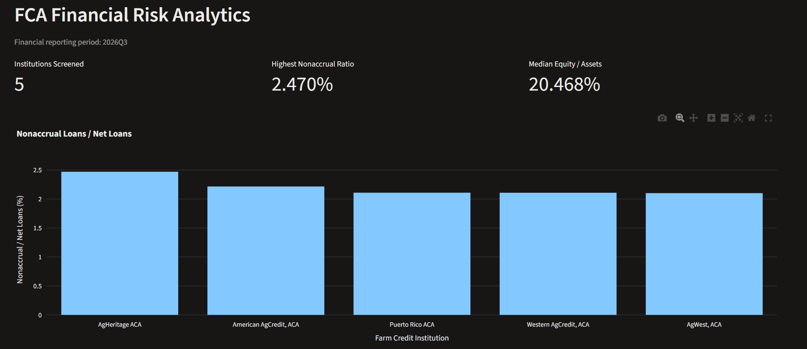
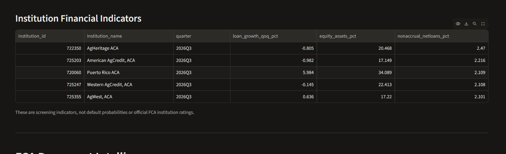
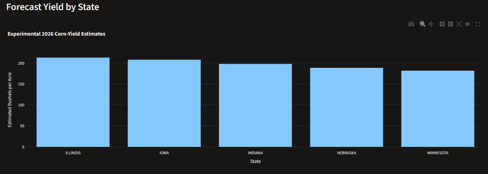
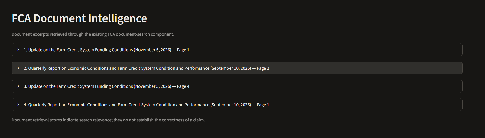

# Farm Credit Intelligence & Analytics Platform

**An independent data science, machine learning, data engineering, and AI research portfolio project.**

This platform integrates Farm Credit Administration (FCA) financial data, USDA agricultural statistics, experimental machine-learning forecasts, regulatory document intelligence, and automated research workflows.

The objective is to demonstrate practical capabilities in financial analytics, data engineering, statistical modeling, reproducibility, and evidence-based research.


## Analytics Dashboard Preview

The Streamlit dashboard integrates financial screening,
agricultural trends, experimental forecasting, and FCA
document intelligence into one interactive interface.

### FCA Financial Risk Analytics



### USDA Agricultural Trends



### Experimental 2026 Corn-Yield Forecasting



### FCA Document Intelligence



All screenshots show the working local research application.
Forecasts are experimental and are not official USDA predictions.

---


## Platform Capabilities

### 1. FCA Financial Risk Analytics

- Analyze institution-level financial and credit-quality indicators.
- Calculate and examine financial ratios.
- Conduct unsupervised anomaly screening.
- Query financial information using SQLite and SQL.
- Compare quarterly performance and identify observations requiring further investigation.

The platform has successfully retrieved 2026 Q3 financial records, including institution-level loan growth, equity-to-assets ratios, and nonaccrual loan ratios.

**Limitation:** Financial screening results do not represent official FCA ratings, default probabilities, or regulatory findings.

### 2. USDA Agricultural Data Engineering

- Process USDA agricultural statistics using PySpark.
- Apply data-quality and eligibility checks.
- Perform transformations using Spark SQL.
- Implement Bronze, Silver, and Gold data-processing layers using Delta Lake.
- Support agricultural analytics and reproducible batch workflows.

The agricultural dataset used in the forecasting demonstration contains 252 source observations, with 164 eligible model-feature records.

### 3. Experimental Agricultural Forecasting

The platform uses scikit-learn Linear Regression to generate experimental 2026 state-level corn-yield estimates.

**Model inputs:**
- Previous-year corn yield.
- Two-year average of historical corn yields.

**Validation strategy:**
- Chronological model development and evaluation.
- Comparison against a previous-year-yield baseline.
- Separate reporting of exploratory 2025 evaluation results.
- MLflow experiment tracking.

| Evaluation Year | Model MAE | Baseline MAE |
|---|---:|---:|
| 2023 | 14.019 | 15.244 |
| 2024 | 16.683 | 17.146 |
| 2025 (exploratory) | 12.405 | 17.780 |

MAE values are measured in bushels per acre.

The average development-validation MAE for 2023–2024 is approximately **15.35 bushels per acre**.

The forecasting workflow generates experimental 2026 estimates for 41 states.

**Important limitations:** These are not official USDA forecasts. The model does not incorporate weather forecasts, commodity prices, soil characteristics, or institution-specific lending exposures. The 2025 evaluation is exploratory and is not an untouched final test.

### 4. FCA Document Intelligence

- Retrieve relevant FCA publications.
- Search indexed document excerpts.
- Return document titles, source URLs, page references, and relevance scores.
- Support evidence-based financial and regulatory research.

Document retrieval results provide supporting references; relevance scores are not measures of factual correctness.

### 5. Autonomous Research Agent

The integrated autonomous research component uses technologies including:

- LangGraph
- LangChain
- Ollama
- Databricks SQL
- Python-based research tools

The agent supports structured research workflows and evidence-validation mechanisms. Its functionality and requirements are documented in the corresponding component repository.

### 6. Unified Streamlit Dashboard

The platform includes a browser-based analytics dashboard with:

- FCA financial screening indicators and charts.
- Historical USDA state-level corn-yield trends.
- Interactive experimental 2026 forecasts.
- State selection and filtering.
- Model-validation metrics.
- Data-lineage metadata.
- FCA document excerpts, source references, and links.

The dashboard is intended as an analytical demonstration rather than a production regulatory application.

## Technology Stack

| Area | Technologies |
|---|---|
| Programming | Python, SQL |
| Data Engineering | PySpark, Spark SQL, Delta Lake |
| Financial Analytics | pandas, SQLite |
| Machine Learning | scikit-learn |
| Experiment Tracking | MLflow |
| Visualization | Streamlit, Plotly |
| AI Research | LangGraph, LangChain, Ollama |
| Cloud Data Analytics | Databricks SQL |
| Testing | unittest, pytest |
| Version Control | Git, GitHub |
| Development Environment | Ubuntu, WSL |

## System Architecture

The repository integrates four component repositories as Git submodules:

1. Financial Risk Analytics
2. USDA Agricultural Data Engineering
3. FCA Document Intelligence
4. Autonomous Research Agent

The master repository provides the shared launcher, experimental forecasting workflow, combined research reporting, dashboard, and integration tests.

### Data and Research Workflow

**Financial workflow**

FCA financial data → SQLite → Financial screening → Combined report / Dashboard

**Agricultural workflow**

USDA statistics → Data validation → PySpark / Delta Lake → Feature engineering → Forecasting → MLflow / Dashboard

**Document workflow**

FCA publications → Document indexing → Retrieval → Source references → Research report / Dashboard

The platform combines the analytical outputs for presentation while maintaining the distinction between agricultural statistics and institution-level financial information.

## Installation and Local Setup

### 1. Clone the repository

```bash
git clone --recurse-submodules https://github.com/AJ277/farm-credit-intelligence-platform.git
cd farm-credit-intelligence-platform
```

### 2. Configure local data sources

Copy the example environment file:

```bash
cp .env.example .env
```

Update the paths in `.env` to match the local FCA financial SQLite database and document repository.

The platform launcher automatically loads these supported configuration values. Environment variables already defined in the shell take precedence.

Do not commit `.env`, database files containing sensitive information, or local credentials.

### 3. Prepare Python dependencies

The dashboard requires Python and the relevant packages, including pandas, Streamlit, and Plotly.

The forecasting workflow also requires the machine-learning dependencies used by its component.

The platform's Spark and autonomous-agent components require their respective configured environments and dependencies.

Refer to the individual component repositories for specialized environment requirements.

### 4. Verify platform integrations

```bash
./scripts/platform.sh finance --limit 5
```

```bash
./scripts/platform.sh documents "Farm Credit System funding conditions" --mode lexical
```

### 5. Generate experimental forecasts

After preparing the USDA source data and forecasting environment:

```bash
./scripts/platform.sh forecast
```

### 6. Generate the combined report

```bash
./scripts/platform.sh combined-report
```

The Markdown research report is generated under `output/`.

### 7. Run the dashboard

With the dashboard environment configured:

```bash
.venv-usda/bin/python -m streamlit run dashboard/app.py
```

Open the local Streamlit URL shown in the terminal, typically:

`http://localhost:8501`

**Note:** Local financial datasets, document indexes, Python environments, and generated forecast artifacts are not automatically provided by cloning the master repository. The appropriate component setup and data preparation steps must be completed before all commands can run.

## Data Integrity and Reproducibility

The experimental forecasting workflow records metadata that includes:

- Model type and feature configuration.
- Forecast year and training-data coverage.
- Validation-year performance metrics.
- USDA source-data SHA-256 fingerprint.
- Forecast-output SHA-256 fingerprint.
- Forecast record count.
- Generation timestamp.

The reporting and dashboard validation logic checks recorded fingerprints and metadata consistency before accepting forecast results.

Modified data with mismatched fingerprints is rejected.

These controls improve reproducibility but do not establish that the model is production-validated.

## Automated Testing

The master platform has successfully completed **18 automated tests**, including:

- Financial and document integration checks.
- USDA preflight integration.
- Forecast-feature construction