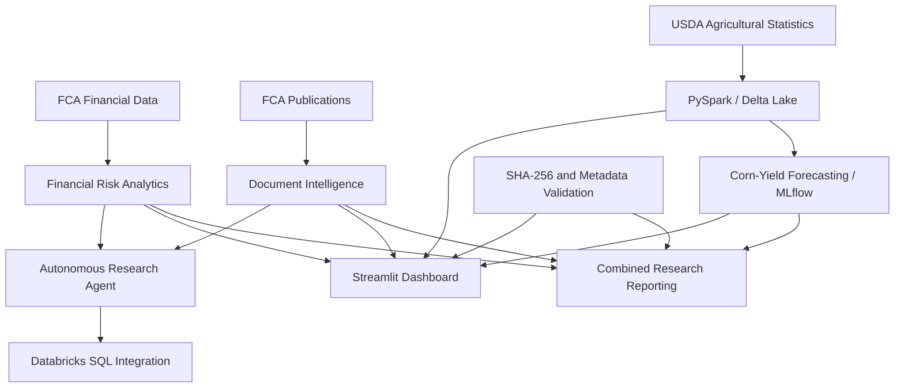

# Farm Credit Intelligence Platform Architecture

## Architecture Overview

The platform maintains four primary components as Git
submodules while the master repository provides shared
integration, forecasting, reporting, and visualization.

### Financial Analytics
FCA call-report data supports institution-level financial
screening and anomaly analysis.

### Agricultural Data Engineering
USDA statistics are processed through PySpark and Delta Lake,
supporting historical analytics and machine-learning features.

### Forecasting
A chronological Linear Regression workflow generates experimental
2026 corn-yield estimates. MLflow tracks experiments, while
SHA-256 fingerprints and metadata support data-lineage checks.

### Document Intelligence
FCA publication excerpts are retrieved with source URLs,
page references, and relevance scores.

### Autonomous Research
LangGraph, Ollama, and Databricks SQL support research
workflows with evidence-validation controls.

### Presentation
Streamlit and Plotly provide the unified analytics dashboard.
The combined Markdown report presents selected financial,
agricultural, forecasting, and documentary information.

## Boundaries

Financial and agricultural datasets are analyzed separately.
The platform does not infer institution-specific crop exposure
or issue official FCA or USDA assessments.
